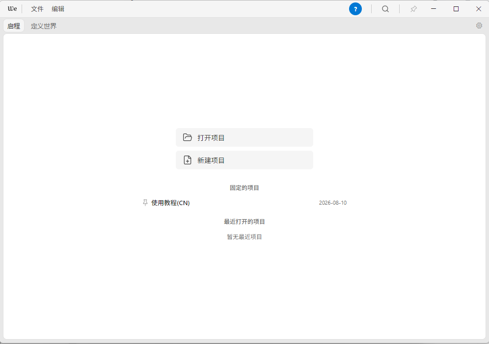
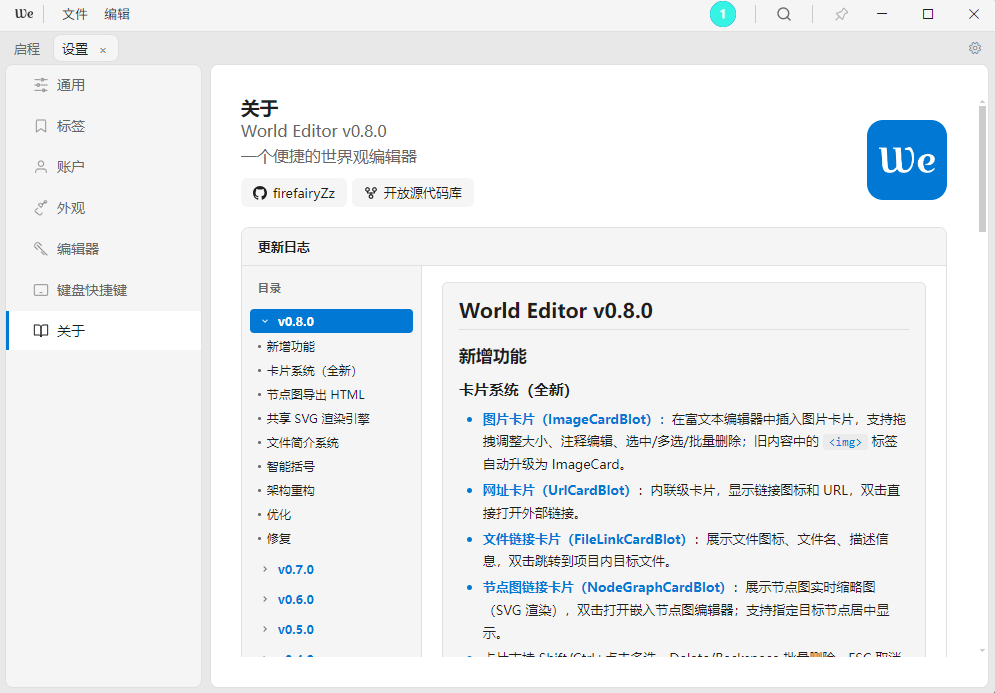

[header_image]Project\World_Editor\header_image.png[/header_image]

[tag]Electron|JavaScript|桌面应用[/tag]

一个基于 Electron 的轻量级世界构建编辑器，专为创作者设计。它不追求大而全的功能堆砌，而是专注于“世界观构建”这一件事。

*代码版本:0.9.0-alpha | 发行版本:0.6.0.2*

---

###
[githublink]查看源码[/githublink](https://github.com/firefairyZz/WorldEditor_WE_)[afdian]支持我[/afdian](https://ifdian.net/a/firefairy)

World Editor 是一个基于 Electron 的桌面应用，面向创作者的世界构建与写作工具。支持项目管理、富文本/Markdown 双模式编辑、文件树浏览、标签系统、多主题、账户系统等功能。

项目采用原生 JavaScript 开发，渲染进程逻辑清晰模块化。支持多格式导出（Markdown / HTML / PDF / ZIP），拥有 13 种预设主题和自定义配色，支持中/英/日/俄四国语言。

## 下载

[win64]Windows安装包[/win64](https://github.com/firefairyZz/WorldEditor_WE_/releases/download/v0.6.0/World.Editor.Setup.0.6.0.exe)[android]Android安装包(暂无)[/android](https://example.com)

---

## 核心功能

[icon]pencil-square-o;Red;img-10px;bk-20px[/icon]{**双模式编辑器**
基于 Quill 的富文本编辑器 + 纯 Markdown 模式（带可折叠实时预览面板），支持文字颜色、背景色、文本对齐等。}

[icon]code-fork;Red;img-10px;bk-20px[/icon]{**节点图编辑器**
纯 SVG/CSS 引擎（NGEngine），5 种节点类型、4 种连线样式、贝塞尔端口、属性面板，支持撤销/重做与缩放平移。}

[icon]paint-brush;Red;img-10px;bk-20px[/icon]{**多主题系统**
13 种预设主题（GitHub、Dracula、Monokai、Nord 等）+ 自定义配色，支持 Windows 11 云母/亚克力材质效果。}

[icon]globe;Red;img-10px;bk-20px[/icon]{**多语言支持**
支持中文 / English / 日本語 / Русский 四种语言，完整的国际化翻译体系。}

## 技术栈

[frame]Electron\桌面框架|Quill\富文本编辑器|JavaScript\原生渲染进程|CSS 变量\主题系统[/frame]